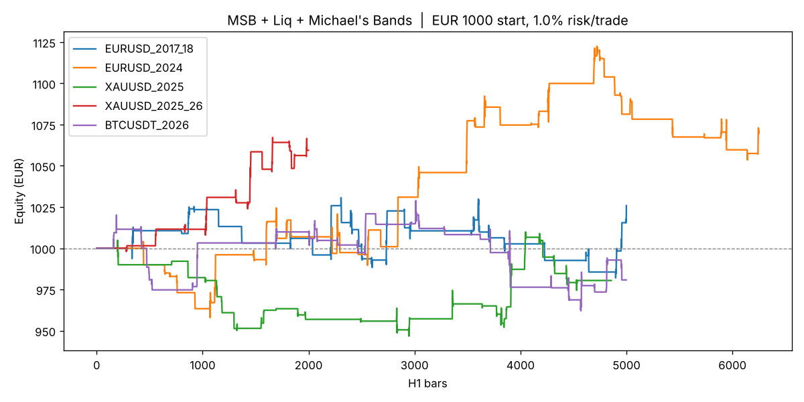

# MSB + Liquidity Sweep + Michael's Bands (H1)

A rules-based version of the **MSB (market structure break) + liquidity** idea
filtered by **Michael's bands** (a fast/slow EMA trend band), built for:

- **Account:** €1000
- **Location / clock:** Plovdiv, Bulgaria (`Europe/Sofia`, EET/EEST)
- **Available:** 09:00 – 00:00 local time, so nothing is held overnight

> ⚠️ **Read the results section before risking money.** The backtests show a *small*
> edge on EURUSD and gold, a loss on BTC (because of fees), and a weak
> out-of-sample result overall. This is not a proven money-maker. Run it on a
> demo account or with 0.5% risk first.

> **About "Michael's bands":** I don't have access to TRW course material, so the
> band is a fast/slow EMA band (default **EMA 21 / EMA 50**, chosen by the
> backtest below). If the Prof uses different lengths or a different band
> type, change `band_fast` / `band_slow` in `msb_liq/strategy.py` (or the Pine
> inputs) and run the backtest again.

---

## The rules (long side, shorts are the mirror image)

| Step | Rule |
|---|---|
| 1. Trend (bands) | Only longs when **EMA21 > EMA50**. Only shorts when EMA21 < EMA50. |
| 2. Liquidity | Mark the last confirmed **swing low** (pivot with 2 candles each side). A **liquidity sweep** is a candle that wicks **below** it and **closes back above** it, taking the stops under the low. |
| 3. MSB | Within **5 candles** of the sweep, a candle **closes above** the last confirmed **swing high**. That's the market structure break. |
| 4. Entry | Market buy at the **open of the next candle**. |
| 5. Stop | Below the sweep wick − 0.1 × ATR(14). Skip the trade if the stop is smaller than 0.5 ATR or bigger than 3 ATR. |
| 6. Target | **3R** (3 × the stop distance). |
| 7. Size | Risk **1% of the account** per trade (€10 on €1000). Lots = €10 ÷ stop distance. |
| 8. Time | New entries **09:00–22:00** Plovdiv time. **Close anything still open at 23:00–00:00.** Max 2 trades per day. |

Timeframe: **1-hour (H1)** candles.

### Your day in Plovdiv time

| Time | What happens |
|---|---|
| 09:00 | Start. Mark the last swing high/low on H1, check the band direction. |
| 10:00 | London open, the first liquidity sweeps usually happen here. |
| 16:30 | New York open, the second active window (15:30 for a few weeks in March and Oct/Nov when US and EU clocks change on different dates). |
| 22:00 | No new trades. |
| 23:00–00:00 | Close any open trade. Go to bed flat. |

---

## Backtest results

€1000 start, 1% risk per trade, spreads and fees included (EURUSD 1 pip,
gold $0.30, BTC 0.1% taker fee per side). If a candle hits both the stop and the
target, the stop is counted first (conservative). Reproduce with
`python -m msb_liq.run`.

| Market | Period | Trades | Win % | Avg R | Profit factor | Net | Max DD |
|---|---|---|---|---|---|---|---|
| EURUSD | Apr 2017 – Feb 2018 | 28 | 35.7 | +0.10 | 1.23 | **+€26** | −4.7% |
| EURUSD | 2024 | 42 | 42.9 | +0.17 | 1.40 | **+€71** | −6.1% |
| Gold (XAUUSD) | Jan – Oct 2025 | 29 | 41.4 | −0.06 | 0.81 | **−€20** | −5.8% |
| Gold (XAUUSD) | Dec 2025 – Apr 2026 | 13 | 61.5 | +0.45 | 3.00 | **+€59** | −1.8% |
| BTCUSDT (spot) | Apr – Oct 2026 | 30 | 36.7 | −0.06 | 0.85 | **−€19** | −6.5% |



### How the settings were chosen (and why to be careful)

`python -m msb_liq.optimize` tests 192 combinations (band lengths, swing
length, R target, MSB window, flat-at-midnight vs hold overnight). Each dataset
is split 60% in-sample / 40% out-of-sample. Settings are ranked **only** on the
in-sample part, then checked on data they never saw (`results/optimize.txt`):

- The chosen settings rank **#1 in-sample (+0.12R/trade)** and stay positive
  out-of-sample, **but only just (+0.04R/trade)**.
- Only **13%** of all combinations were profitable in-sample. Most versions of
  "MSB + liquidity" lose money after costs, so treat this edge as fragile.
- **Closing before midnight beats holding overnight.** With stops/targets left
  running overnight, gold 2025 and BTC each lost about 9%.
- The 3R target is rarely reached before midnight. Most trades are closed by
  the session-end rule, so it works more like "catch the intraday move after
  the MSB" than a 3R strategy.
- Each dataset has only 13–42 trades. That is too few to be statistically sure.

### What to trade with €1000

1. **EURUSD** was the most consistent (profitable in both periods) and has the
   lowest costs. Start here.
2. **Gold** was mixed: one losing period, one good one.
3. **Avoid BTC spot with this strategy.** The 0.1% fee on each side costs about
   0.4R per trade and wipes out the edge. Also, a 1%-risk position with a tight
   stop needs about €2000 notional, which is more than a €1000 spot account
   can buy.

With €1000 and 1% risk (€10), a EURUSD stop of 15 pips is about 0.06 lots.
You need a broker that allows **micro lots (0.01)**. On EURUSD 2024 the
backtest made about €6 a month. That's a skill-building account, not an income.

### Suggested plan before going live

1. Put `pine/msb_liq_michaels_bands.pine` on a TradingView **EURUSD 1H** chart
   and check the Strategy Tester on as much history as your plan allows.
2. **Paper or demo trade it for 4–6 weeks** (aim for at least 30 trades) and
   log every trade.
3. Go live only if the demo results are close to the backtest. Start at
   **0.5% risk**.
4. Hard stop rule: if the account drops 10% (to €900), stop and re-evaluate.

---

## Files

```
msb_liq/strategy.py   strategy + bar-by-bar backtester (no look-ahead)
msb_liq/data.py       loaders/timezones/costs for the bundled datasets
msb_liq/run.py        run all markets -> results/summary.csv, trades_*.csv, equity.png
msb_liq/optimize.py   in-sample / out-of-sample parameter study
pine/msb_liq_michaels_bands.pine   TradingView version (Pine v5)
data/                 H1 OHLC data (public GitHub datasets, see below)
```

```bash
pip install pandas numpy matplotlib
python -m msb_liq.run                    # backtest, 1% risk
python -m msb_liq.run --risk 0.5         # 0.5% risk
python -m msb_liq.run --hold-overnight   # compare: leave SL/TP running overnight
python -m msb_liq.optimize 15            # parameter robustness table
```

**Data sources** (public repos, timezones handled in `data.py`):
EURUSD 2024 (Sigmanumeric78/MACD-crossover), EURUSD 2017–18 (`backtesting.py`
sample data), XAUUSD 2025 MT5 export (budimanlai/forex-tick), XAUUSD
2025–26 (TshifhunguCodes/Autonomous-Quant-Research-system), BTCUSDT 2026
(Agus27712/analisa-pasar). For a serious test, export a few years of H1 data
from your own broker and add it to `DATASETS`.

*Not financial advice. Leveraged FX/CFD trading carries a high risk of loss.*
