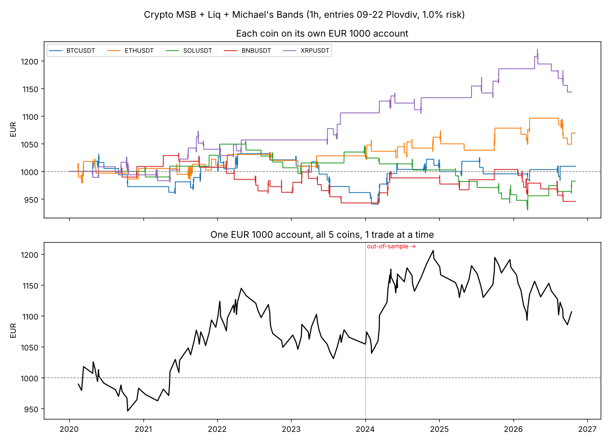

# Crypto: MSB + Liquidity Sweep + Michael's Bands

A rules-based **crypto** strategy built on the TRW-style idea of a **liquidity
sweep → market structure break (MSB)**, filtered by **Michael's bands** (a
fast/slow EMA trend band). It's set up for:

- **Account:** €1000
- **Location:** Plovdiv, Bulgaria (`Europe/Sofia`)
- **Screen time:** 09:00 – 00:00. Entries happen only while you're awake. The stop-loss
  and take-profit orders sit on the exchange overnight.
- **Markets:** USDT perpetual futures on BTC, ETH, SOL, BNB, XRP (1-hour chart)

> ## ⚠️ Read this first: the honest result
> I tested this on **6.8 years of real Binance futures data (2020 → Nov 2026,
> 5 coins, ~290,000 candles)** with real fees. **The best version I found is only
> slightly profitable, and the edge is not statistically proven:**
>
> - One €1000 account trading all 5 coins: **€1000 → €1,106 in 6.8 years
>   (about +1.5%/year)**, with a max drawdown of −10%. **4 of the 7 years were losing years**, including 2026 (−6%).
> - Average **+0.086R per trade** (R = the amount you risk on a trade). A bootstrap test gives about a **21% chance the
>   real edge is zero or negative**. So it's roughly "breakeven-plus", not a money-maker.
> - Most versions of this idea **lose money on crypto** after fees (details below).
>
> Treat this as a structured way to learn and journal MSB/liquidity trading on a
> demo account, **not** as a way to grow €1000. Never risk more than 1% per trade.

> **About "Michael's bands":** I don't have TRW course access, so the band is
> an **EMA 21 / EMA 50** band. If the Prof uses other lengths or another band
> type, change `band_fast` / `band_slow` (Pine inputs, or `CRYPTO` in
> `msb_liq/crypto.py`), then rerun the backtest.

---

## The rules (1-hour chart; shorts are the mirror image)

| Step | Rule |
|---|---|
| 1. Bands | Longs only when **EMA21 > EMA50**. Shorts only when EMA21 < EMA50. |
| 2. Liquidity | Mark the last confirmed **swing low**, a pivot with **5 candles on each side**. A **sweep** is a candle that wicks **below** that low and **closes back above** it, grabbing the stops under it. |
| 3. MSB | Within **5 candles** of the sweep, a candle **closes above** the last confirmed **swing high**. |
| 4. Entry | Market order at the **open of the next candle**. Only if that candle opens **09:00–22:00 Plovdiv time**. Max 2 trades a day. |
| 5. Stop | Below the sweep wick − 0.1 × ATR(14). **Skip the trade** if the stop is **less than 1% from entry**, because fees would eat the profit. Also skip it if the stop is under 0.5 ATR or over 3 ATR. |
| 6. Target | **2R**. |
| 7. Size | Risk **1% = €10** per trade. Position size = €10 ÷ stop distance, capped at 5× leverage. With a typical 1–2% stop, the position is €500–€1000, so usually **1× leverage or less**. |
| 8. Overnight | Leave the stop and target orders on the exchange. **Don't move them**. |

**Frequency:** about 2 trades a month across all 5 coins (182 trades in 6.8 years).
The median trade lasts about 20 hours. 61% of trades hit the stop and 39% hit the 2R target.

### Daily routine (Plovdiv time)
| Time | Action |
|---|---|
| 09:00 | Check the 1H charts of the 5 coins: band direction, last swing high/low. Set TradingView alerts on the script. |
| During the day | On an alert, check the rules above, then place a market entry, stop and target **all at once**. |
| 22:00 | No new entries. |
| Night | Orders do the work. Don't wake up to trade. |

---

## Results (chosen settings, fees + funding included)

Costs: 0.05% taker fee + 0.02% slippage on each side, and 0.01% funding every 8 hours while in a trade.
When a candle touches both the stop and the target, the stop is counted (conservative).
Reproduce with `python -m msb_liq.crypto run`.

**Per coin (each on its own €1000 account, 2020 – Nov 2026):**

| Coin | Trades | Win % | Avg R | Profit factor | End € | Max DD |
|---|---|---|---|---|---|---|
| XRP | 37 | 48.6 | +0.37 | 1.64 | **1,143** | −6.3% |
| ETH | 38 | 42.1 | +0.19 | 1.28 | **1,069** | −4.3% |
| BTC | 45 | 37.8 | +0.03 | 1.03 | **1,009** | −9.1% |
| SOL | 27 | 33.3 | −0.06 | 0.91 | **982** | −11.8% |
| BNB | 35 | 31.4 | −0.15 | 0.79 | **946** | −8.7% |

**Per year (all coins):**

| 2020 | 2021 | 2022 | 2023 | 2024 | 2025 | 2026 |
|---|---|---|---|---|---|---|
| −0.08R | **+0.51R** | −0.11R | −0.03R | **+0.42R** | +0.13R | −0.19R |

**One €1000 account, all 5 coins, one trade at a time:**
158 trades, **€1,106 at the end**, max drawdown −10%. Yearly returns: 2020 −1.7%, 2021 +10.0%,
2022 −3.0%, 2023 +1.5%, 2024 +12.0%, 2025 −1.2%, 2026 −6.1%.



Don't pick "just XRP and ETH" because they did best here. That's hindsight. Choosing
coins after seeing the results is exactly how backtests end up lying.

---

## How the settings were chosen, and what didn't work

Settings were ranked **only on 2020–2023**, then checked on **2024–Nov 2026**
(data they never saw). Full tables are in `results/crypto/optimize_stage*.txt`.

| Test | Settings tried | Profitable 2020–23 | Profitable 2024–26 | Verdict |
|---|---|---|---|---|
| 1. Plain MSB + liq + bands, 1h | 216 | 7% | 11% | ❌ Mostly loses after fees |
| 2. + higher-timeframe trend filter / long-only | 288 | 16% | 27% | ❌ Filter didn't help |
| 3. Same idea on 4h candles | 96 | 41% | 18% | ❌ Overfit, best in-sample did worse later |

What held up:
- **Bigger swings (5-candle pivots).** Small swings were mostly noise.
- **Stop at least 1% from entry.** With tight stops, fees cost about 0.15–0.4R per trade.
- **Letting stop and target run overnight.** Closing at midnight was clearly worse on crypto.
- The chosen settings and the similar settings around them were positive in **both** periods:
  +0.07R in 2020–23 and +0.11R in 2024–26.

---

## Practical setup for €1000 in Bulgaria

1. **Exchange:** use a crypto exchange that's licensed in the EU (MiCA) and
   available to Bulgarian residents. Check whether it offers perpetual futures
   to retail EU clients, because some don't. If you can only trade **spot**, the strategy
   works **long-only**. Spot fees are usually 0.1%, though, which hurts. Use limit/maker orders where you can.
2. **TradingView:** add `pine/msb_liq_michaels_bands.pine` to a **1H** chart of
   each coin's perpetual (e.g. `BINANCE:ETHUSDT.P`). Defaults match the settings above.
   Create an alert on each chart.
3. **Demo first:** paper trade it for 2–3 months. At about 2 trades a month, even
   that is only about 5 trades, so the real test is following the rules without exceptions.
4. **Live:** start at **0.5% risk (€5)**. Stop and re-evaluate if the account drops to €900.
5. **Tax:** crypto gains are taxable in Bulgaria, so keep the trade log.

---

## Files

```
msb_liq/strategy.py      strategy + bar-by-bar backtester (no look-ahead)
msb_liq/crypto.py        crypto data, costs, chosen settings, optimizer, report
pine/msb_liq_michaels_bands.pine   TradingView version (defaults = crypto settings)
data/crypto/*.csv.gz     Binance USD-M 1h candles 2020 -> Nov 2026 (BTC ETH SOL BNB XRP)
results/crypto/          summary.txt, trades.csv, equity.png, optimize_stage1-3
FOREX.md                 the earlier EURUSD/gold version (msb_liq/run.py)
```

```bash
pip install pandas numpy matplotlib
python -m msb_liq.crypto run          # report for the chosen settings
python -m msb_liq.crypto optimize 1   # plain idea, 1h
python -m msb_liq.crypto optimize 2   # + trend filter / long-only
python -m msb_liq.crypto optimize 3   # 4h candles
```

Data source: Binance USD-M futures klines from the public GitHub repo
`richardrank13-spec/atlas-data`. I checked the files: no broken candles and
fewer than 5 gaps per coin.

*Not financial advice. Crypto and leveraged trading carry a high risk of loss.*
